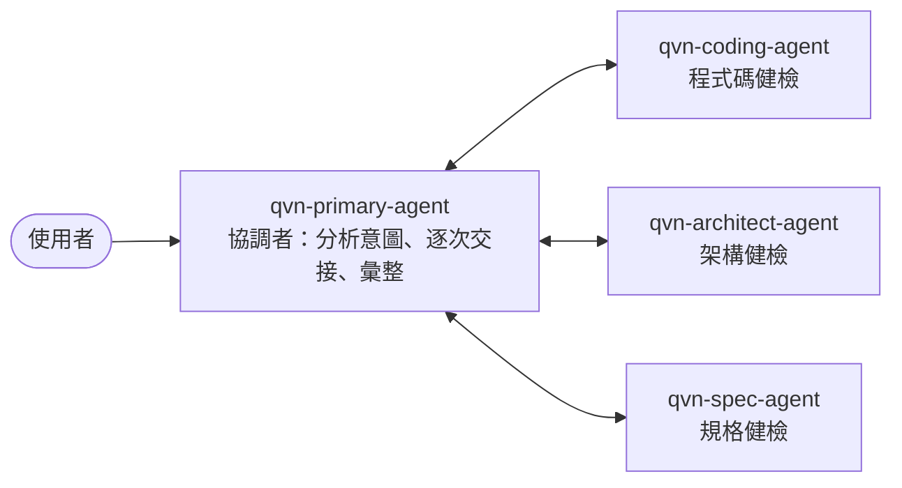

# IPM Multiagent System 技轉工作坊

用 Microsoft Agent Framework 與 Microsoft Foundry，從零建出一個 Multiagent system，並部署到 Foundry hosted agent、發布到 Microsoft Teams。

**對象**：有 Python 基礎、AI 代理人基礎觀念的 AI 開發者

---

## 邏輯架構



**定義檔是唯一事實來源。** `src/agents/` 的內容同時餵給持久化 agent 與執行期參與者，
角色定義不另抄一份；Handoff runtime 另外加上交接／忠實呈現保護，
不表示持久化角色與 runtime 的 middleware／模型 history 選擇完全相同。

---

## 課程結構

| 講義                                                      | 內容                           |
| --------------------------------------------------------- | ------------------------------ |
| [00 Lab 0：環境驗證](docs/00-lab0-env-check.md)           | 環境、權限、`.env`、preflight  |
| [01 Lab 1：單一 Agent](docs/01-lab1-single-agent.md)      | 在 portal 手動建立第一個 agent |
| [02 Lab 2：多代理與 Handoff](docs/02-lab2-multi-agent.md) | 程式碼建立、拓撲、DevUI        |
| [03 Lab 3：部署到 Azure](docs/03-lab3-deploy.md)          | 容器化、`azd`、traces          |
| [04 Lab 4：發布到 Teams](docs/04-lab4-publish-teams.md)   | Direct publish、1:1 對話       |
| [05 收尾與清理](docs/05-cleanup.md)                       | 刪資源、誠實揭露               |
| [06 如果你卡住了](docs/06-fallback.md)                    | 觀摩路徑與會後重跑（備援）     |

[solutions/](solutions/README.md) 提供各 lab 的完成版，複製覆蓋即可繼續。

---

## 專案結構

```text
src/
├── agents/          Lab 1・2     四個 agent 的定義檔（唯一事實來源）
├── models/          Lab 1・2     結構化輸出的資料模型
├── workflows/       Lab 2        Handoff 拓撲
├── registry/        Lab 2・收尾  agent 的建立與清理腳本
├── preflight/       Lab 0        六項環境檢查
├── fixtures/        Lab 2・3     12 題測試題組
├── config.py        Lab 2・3     環境設定的載入與驗證
└── main.py          Lab 2・3     DevUI 與 Responses 兩種進入點

deploy/              Lab 3・4     部署資產（Dockerfile、azd、agent manifest、infra）
docs/                全程         講義
solutions/           備援         各關完成版（救援用）
```

各 Lab 會用到的指令：

| 關卡  | 你會用到                                                                           |
| ----- | ---------------------------------------------------------------------------------- |
| Lab 0 | `uv run python -m preflight`                                                       |
| Lab 1 | 從 `agents/coding.py` 取 instructions、從 `models/specialist_review.py` 取輸出格式 |
| Lab 2 | `uv run python -m registry.create_agents`、`uv run python main.py`（DevUI）        |
| Lab 3 | `azd provision`、`azd deploy`（容器內跑的是 `main.py --responses`）                |
| Lab 4 | Foundry portal 發布，加上 `azd ai agent show` 確認狀態                             |
| 收尾  | `uv run python -m registry.cleanup`、`azd down`                                    |

---

## 環境變數

放在 `src/.env`（從 `src/.env.template` 複製）：

| 變數                       | 說明             | 從哪裡拿                                                           |
| -------------------------- | ---------------- | ------------------------------------------------------------------ |
| `FOUNDRY_PROJECT_ENDPOINT` | Foundry 專案端點 | portal → 你的專案 → 首頁 → 複製「專案端點」                        |
| `MODEL_DEPLOYMENT_NAME`    | 模型部署名稱     | portal → 你的專案 → Deployments → 複製「部署名稱」（不是模型型號） |

本機目標由 `.env` 載入；Azure 部署另使用 azd environment。
修改 `.env` 不會自動更新已部署 agent、版本或路由，部署前須重新核對並匯入。

---

## 本機執行

### 環境檢查

```bash
cd src
uv run python -m preflight
```

六項全過再往下。詳見 [Lab 0：環境驗證](docs/00-lab0-env-check.md)。

### 建立 agent

```bash
cd src
uv run python -m registry.create_agents
```

> 這支腳本**不會**建立 `qvn-coding-agent`——那是 Lab 1 在 Foundry portal 手動建立的。

### 啟動 DevUI

```bash
cd src
uv run python main.py
```

執行後，在瀏覽器輸入：`http://localhost:8080`。

畫面上會有**兩個**項目，它們是同一套四代理系統的兩種呈現：

| 實體                      | DevUI 類別 | 畫面長什麼樣                       |
| ------------------------- | ---------- | ---------------------------------- |
| `qvn-ipm-review`          | `agent`    | 一個聊天框（Lab 3 部署出去的樣子） |
| `qvn-ipm-review-workflow` | `workflow` | 一張拓撲圖加上 Execution Timeline  |

用來展示 DevUI 同時支援 agent 與 workflow 兩種類別。
兩者有**已知限制**（狀態會跨對話殘留、圖上的線不等於可交接對象），
詳見 [Lab 2](docs/02-lab2-multi-agent.md) 的說明。

> ⚠️ DevUI 以 `auth_enabled=False` 啟動，這是 **不是適用於正式環境**。
> 瀏覽器顯示 400 時改用 `uv run python main.py --forward`。

### 確認拓樸

不確定拓樸是不是你以為的那樣時，直接列出每位 agent 允許交接的對象：

```bash
cd src
uv run python -c "
import asyncio
from azure.identity.aio import AzureCliCredential
from config import load_settings_or_exit
from workflows.handoff import create_workflow

async def main():
    s = load_settings_or_exit()
    async with AzureCliCredential() as cred:
        wf = create_workflow(s.foundry_project_endpoint, s.model_deployment_name, cred)
        for e in wf.get_executors_list():
            print(f'{e.id:22} -> {sorted(e._handoff_targets)}')
asyncio.run(main())
"
```

三位專家的可交接對象都只有 `qvn-primary-agent`——專家之間沒有直接邊。

---

## 部署

**截至 2026-10-14**，[PR #6](https://github.com/ownway22/workshop-ipm-multiagent-system-student/pull/6)
已合併，是 SDK 升級與既有 runtime 補強；仍使用 HandoffResponsesHost／Responses 2.0.0。
新 image 只在獨立 `qvn-ipm-review-sdk6-validation` 的 regular version 6 受測，
不是原 `qvn-ipm-review` 的 version 6，原 agent active／latest 路由未隨 merge 切換。

下列是**首次部署到已獲准目標**的入口，不是共用環境的無條件升級命令。
新增 azd environment 不等於隔離 project／agent；共用目標及路由影響先取得授權。

```bash
# 起始目錄：repository 根目錄
cd deploy
azd env new ipm-workshop
uv run --project ../src --locked python scripts/configure_azd_env.py
azd provision
azd deploy
azd ai agent show --output json
```

匯入工具會從已驗證的 `src/.env` 取得專案端點與模型部署名稱，再透過目前的 Azure CLI 登入自動查出訂閱、租戶、資源群組、區域、Foundry 帳戶、專案名稱及 ARM ID；不需回 portal 手動抄值。

既有升級先選取正確 environment、確認 ACR／授權接線，不能盲目重跑 provision。
Source／image／版本／路由／session 核對、新對話、T01 三輪與停止 compute 的操作，
見 [Lab 3](docs/03-lab3-deploy.md)；active／readiness 200 不代表新版實際驗收成功。

基礎設施刻意極小：只建立一個 Container Registry 與必要授權。
**不會**佈建 Foundry 專案或模型部署——那是你的既有資產。

---

## 發布到 Teams

Foundry portal → Agents → `qvn-ipm-review` → **Publish**
→ **Teams and Microsoft 365 Copilot** → **Direct publish** → **「Just you」**。

完整步驟見 [Lab 4](docs/04-lab4-publish-teams.md)。

⚠️ **僅支援 1:1 私訊**。頻道提及與群組聊天不支援。

---

## 清理

```bash
cd src
uv run python -m registry.cleanup            # 先看要刪什麼
uv run python -m registry.cleanup --confirm  # 真的刪
```

Container Registry 與 Bot Service 要另外處理，見 [收尾與清理](docs/05-cleanup.md)。

---

## 疑難排解

各講義末尾都有「常見失敗」表。最常見的幾個：

| 現象                              | 處理                                                             |
| --------------------------------- | ---------------------------------------------------------------- |
| preflight 說權限不足              | 訂閱 Owner **不包含** `Foundry Project Manager`，要另外指派      |
| 找不到 `qvn-coding-agent`         | `.env` 指向的專案與 portal 上的不同；比對錯誤訊息裡的 agent 清單 |
| DevUI 顯示 400 Bad Request        | 改用 `uv run python main.py --forward`                           |
| 部署後 `azd ai agent show` 回 404 | `azure.yaml` 的服務名稱必須等於 `agent.yaml` 的 `name`           |
| 休息後第一則訊息很慢              | 核對本次 session／閒置設定與 console，可能是冷啟動；不要直接重 deploy |
| 改版後行為還是舊的                | 核對 image／版本與 session binding；新建 session／conversation，不以刪除舊資料作預設 |
| 找不到 traces／exporter Bad Request | Telemetry 接線仍有已知問題；分開確認，不能直接當 Handoff 根因 |

環境本身修不好時走 [觀摩路徑](docs/06-fallback.md)。

---

## 版本

### 正式 SDK 升級，保留既有 Handoff host

PR #5／#6 均已合併，精確版本以 [pyproject.toml](src/pyproject.toml)／[uv.lock](src/uv.lock) 為準：
core **1.21.0**、foundry **1.14.1**、
orchestrations **1.3.1**、DevUI／foundry-hosting **1.0.0b261008**、
agentserver core **2.1.0**／Responses **2.2.0b1**，其他非必要相依不升級。
預設仍為 `HandoffResponsesHost`，與救援程式一致；新版正式環境
**54 tests、117 subtests 通過**。Source／image 已部署到獨立測試 agent，
合併門檻是接受限制後的「指定 T01 流程」，**不是完整 12 題或 Lab 2 → Lab 3 → Lab 4 全鏈路通過**。

[實際 source build／smoke run](https://github.com/ownway22/workshop-ipm-multiagent-system-student/actions/runs/38502942437)
通過，受測 runtime source 為 `752699b`，不是文件回填的 skipped build。
首次部署驗收使用新 session／conversation；舊 checkpoint 僅有合成案例相容證據，
不做自動遷移或刪除。

Canonical T01 的 1,596 字元 API 三輪通過；GUI 指定流程使用 1,646 字元 raw CSV 變體，
兩者不混稱同一輸入的 API／GUI 驗收。Canonical GUI 證據與額外自由詢問短回覆由
[#7](https://github.com/ownway22/workshop-ipm-multiagent-system-student/issues/7) 追蹤。
新 image T03／T10／T12 未重測，T12 漏 Architect 歷史限制與 telemetry 問題保留，
不宣稱任意追問或所有題目通過。操作與驗收範圍以 [Lab 3](docs/03-lab3-deploy.md) 為入口，
完整日期／FAIL／skip 證據見 [SDK 升級紀錄](docs/native-hosting-migration.md)。

Native 純文字續接能力與官方線性 lineage／既有分岔契約是**獨立 migration blockers**，
不是正式 adapter 的 regression failures，也不在本次 SDK 升級的解決範圍。
實驗版本與證據保留於 [相容性報告、Docker 設定與後續門檻](docs/native-hosting-migration.md)、
[known gaps](references/known-gaps.md)；不宣稱 native migration 完成。

所有相依都**釘死版本**。升級任一 `agent-framework` 套件時，
**必須**重跑 Lab 2 → Lab 3 → Lab 4 全鏈路——
套件、目前使用的 host 與 `deploy/agent.yaml` protocol 必須一起核對，
不能假設升套件或 merge 就自動切換託管協定、路由或既有 session。

### 成熟度：這條鏈路不是每一層都是穩定版

底層的**服務**（Foundry hosted agents）已 GA，**框架核心**（`agent-framework-core`、
`-foundry`、`-orchestrations`）是穩定版——多代理協調這個概念本身站得住腳。

不穩定的是把它接到託管與本機工具的那幾層黏著劑：`agent-framework-devui` 與
`agent-framework-foundry-hosting` 是 **prerelease**，其傳遞相依 `azure-ai-agentserver-*`
仍包含 prerelease（Responses 是 beta；core／invocations 已有穩定版），
`azd ai agent` 擴充是 **preview**，建立持久化 agent 用的 `to_prompt_agent()`
標記為 **Experimental**（執行時會印出 `ExperimentalWarning`，那不是錯誤）。

意涵：這條路徑**能用**，但 API 可能在沒有向後相容承諾的情況下變動。
把它當成「現在可行的做法」，不是「長期穩定的介面」。

---

## 參考資料

1. [Microsoft Foundry Agent Service - Overview](https://learn.microsoft.com/en-us/azure/foundry/agents/overview)
2. [Foundry Hosted Agent – Overview](https://learn.microsoft.com/en-us/azure/foundry/agents/concepts/hosted-agents?view=foundry)
3. [Microsoft Agent Framework – Overview](https://learn.microsoft.com/en-us/agent-framework/overview/?pivots=programming-language-python)
4. [Hands-on Lab: Microsoft Agent Framework with Microsoft Foundry](https://moaw.dev/workshop/gh:microsoft/hands-on-lab-agent-framework-with-microsoft-foundry/main/docs/) (300分鐘)
5. [Hands-on Lab: Develop AI Agents in Azure (L300)](https://microsoftlearning.github.io/mslearn-ai-agents/) (360分鐘)

---

## 授權

見 [LICENSE](LICENSE)。

---

Happy coding 💜
